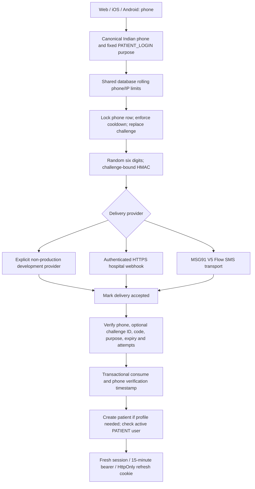

# OTP authentication implementation

## Scope and previous implementation

Audited local web, iOS and Android repositories against the attached readiness brief. No commits, pushes, resets, stashes, or saved clinical database migrations were performed. Existing clinical QA changes were retained and extended.

The previous v2 patient route already used crypto.randomInt, six digits, HMAC-SHA256 with JWT_SECRET, a five-minute expiry, five attempts, one row per normalized phone, transactional consumption, and an authenticated HTTPS SMS webhook. Explicit OPD_DEMO_OTP returned development_code in JSON; it did not merely print codes. The demo seeder printed entire responses, including synthetic access tokens. That logging was removed. Legacy activation/password patient routes remain local-only and are blocked by deployment configuration.

## Architecture and lifecycle

Implementation: `backend/opd/otp.ts` supplies OtpDeliveryProvider, delivery adapter, configuration and shared rate limiting. Auth routes own patient/session integration. Raw OTPs exist only transiently for delivery; stored HMAC binds fixed purpose, phone, challenge UUID and code. Delivery must be accepted before verification. Non-2xx, timeout and redirects fail closed and invalidate the matching challenge. HTTP acceptance is NOT proof of handset receipt. There is no console fallback.

Only PATIENT_LOGIN exists today; it covers OTP-authenticated onboarding and login. Phone changes and recovery are not enabled by arbitrary purpose strings. Unknown purposes fail. Missing purpose defaults to PATIENT_LOGIN for existing clients. Optional challenge_id is checked when supplied; existing mobile clients authenticate the latest phone challenge without sending it. The server hash always binds the challenge even for legacy clients. Resend overwrites the sole current phone row. Production must never expose development_code.

A correct code for an unregistered phone can return PROFILE_REQUIRED without consuming the challenge; the user can supply a profile within its lifetime. Invalid codes consume attempts. Expired/consumed/locked/wrong-challenge errors are generic. Request responses do not disclose account existence. Disabled patients cannot receive a session. The registration distinction appears only after proving phone possession.

## Database and migration

Migration 017 adds challenge_id, purpose, delivered to patient_otps; phone_verified_at to patients; and otp_rate_buckets (HMAC-pseudonymized key and bounded rolling timestamp array). Existing patients are not marked verified. Existing pending OTPs have delivered=0 and must be requested again. No clinical records are deleted or rewritten. Successful verification writes phone_verified_at in the same transaction as consumption/session creation.

PostgreSQL uses stable-row INSERT ON CONFLICT plus FOR UPDATE; SQLite uses the existing serialized BEGIN IMMEDIATE transactions. Conditional consumption provides an additional guard. Shared database rate buckets survive restarts and multiple app workers. Acquire bucket locks in sorted order. Counts include requests rejected later by cooldown and verification successes: intentionally conservative. Each bucket keeps only the last hour on access. Inactive bucket-row retention requires an operational policy; no automatic deletion added.

Migration 017 is column-aware and re-entrant. Run `npm --prefix backend run migrate` only during an approved deployment against a backed-up database. This task migrated disposable fixtures only. Existing migration 016 contains a SQLite table rebuild and broad PostgreSQL error catches; production upgrades still require a backup/restore and migration rehearsal. Changing JWT_SECRET also invalidates OTP hashes and changes rate-bucket keys; coordinate key rotation with deployment limits.

## Configuration

| Variable | Default / requirement |
|---|---|
| OPD_DEMO_OTP | false; true only explicitly in non-production/non-pilot tests |
| OTP_DELIVERY_PROVIDER | explicit `development`, `webhook`, or `msg91` selection |
| SMS_WEBHOOK_URL | authenticated hospital adapter HTTPS URL, no embedded credentials |
| SMS_WEBHOOK_TOKEN | secret-store bearer credential |
| MSG91_AUTH_KEY | server-side secret-store credential; required for `msg91` |
| MSG91_TEMPLATE_ID | MSG91 Flow template mapped to approved DLT content; required for `msg91` |
| MSG91_OTP_VARIABLE | exact case-sensitive Flow variable receiving the OTP; required for `msg91` |
| OTP_TTL_SECONDS | 300 |
| OTP_COOLDOWN_SECONDS | 60 |
| OTP_MAX_ATTEMPTS | 5 |
| OTP_PHONE_15M_LIMIT | 5 |
| OTP_PHONE_HOURLY_LIMIT | 10 |
| OTP_IP_15M_LIMIT | 20 |
| OTP_IP_VERIFY_15M_LIMIT | 20 |
| JWT_SECRET | strong >=32-character deployment secret |
| DB_DIALECT / DATABASE_URL | postgres / production database secret |
| CORS_ORIGIN | explicit HTTPS frontend origins |
| COOKIE_SECURE | true in locked deployments |
| COOKIE_SAME_SITE | existing deployment choice; none requires Secure |
| TRUST_PROXY | unset/direct by default; comma-separated trusted proxy IPs/subnets |

Positive integer OTP settings are validated at module startup. Production remains locked even with APP_ENV=staging: demo mode is rejected and SMS credentials are mandatory. Non-production staging may explicitly use development OTP. Production and restricted pilot require PostgreSQL, strong signing secret, HTTPS CORS, secure cookies and legacy API disabled. Configure network access so only trusted ingress can reach the backend. Never use a blanket proxy trust range.

## SMS providers / India setup

The existing webhook remains available. It receives `{phone, template, variables, challenge_id}` with template PATIENT_LOGIN_OTP and variables code / expires_minutes. Existing notification delivery continues using the webhook without challenge_id.

The patient OTP path can instead select MSG91. `Msg91OtpProvider` posts only to the fixed HTTPS V5 Flow endpoint, supplies the auth key in the server-side `authkey` header, sends the configured `template_id`, converts canonical `+91XXXXXXXXXX` to `91XXXXXXXXXX` only at the provider boundary, and maps the transient OTP under `MSG91_OTP_VARIABLE`. It rejects redirects, malformed phones, timeouts, HTTP errors and non-success/malformed provider responses. It never logs credentials, OTPs, provider bodies or full phone numbers. HTTP acceptance is not proof of handset delivery. No real SMS was sent in this task.

For Indian delivery, obtain Principal Entity registration, an approved sender/header and DLT content template, then map that exact template in MSG91 and use its MSG91 template ID. Do not invent identifiers or message text. Verify the case-sensitive Flow variable name before enabling delivery.

## Local development and tests

`npm run dev:demo` explicitly enables the development provider. Demo seeding rejects production and every non-local APP_ENV before changing environment values. Retain synthetic catalogues and disposable databases. Never seed a production database from a local process; deployment credentials must enforce that boundary.

`npm --prefix backend run test:otp` runs real route/database security tests; only the external SMS transport is simulated in the production-route suite. That suite mounts production-mode auth routes with SQLite without claiming full production boot. Production startup validation is separately tested. PostgreSQL tests use scripts/isolated-postgres.cjs and dedicated local temporary databases. Existing mobile phone/code payloads remain valid; web supplies challenge_id.

## Browser and sessions

The browser uses memory-only access tokens, with a HttpOnly refresh cookie, secure in production, path /api/v1/auth, 30-day expiry. Fifteen-minute JWTs bind to a database session; every authenticated request checks current user state and live session. Refresh secrets are hashed and rotated. Logout/session revocation invalidate bound access immediately; failed logout retains retry credentials. No migration to a new cookie/bearer architecture.

Locked CORS rejects unlisted browser Origins before routes; cross-site Fetch Metadata without an Origin is additionally rejected for auth mutations. Native clients without browser metadata remain compatible. Validate reverse-proxy behavior and actual deployment cookie policy before pilot. Bearer theft still permits replay until expiration/revocation: these are not proof-of-possession tokens.

Web now includes resend countdown, challenge binding, masked destination, clearing stale code after phone change, numeric six-digit input and one-time-code autofill. Generic invalid/expired/used response is deliberate. Rate-limit and delivery messages are user-facing. Registration remains an explicit profile checkbox after phone entry. Session expiry and logout behavior are preserved. Browser storage retains language/logout markers; legacy ClinicalNoteEditor has local draft storage requiring deployment-surface review.

## RBAC / staff

ADMIN is reception/administration in this pilot: create/confirm/reschedule/check-in allowed, clinical record access denied unless separately authorized by existing domain paths. DOCTOR can book/confirm/check-in on their own schedule and consult/prescribe/order/review labs on assigned encounters. NURSE cannot create or confirm bookings; triage and lab operations remain scoped to their department. Patient can request and reschedule/cancel own eligible appointments, read own records and released results. A future LAB_TECH role and independent result verification are recommended if hospital staffing needs them; none was added.

Staff remains bcrypt password authentication with required password changes, database lockout, IP/account throttles and active-user/session checks. Staff MFA is RECOMMENDED BEFORE PILOT for a restricted internal network pilot; public privileged access without compensating controls should not be approved. No staff SMS-OTP migration was introduced. Existing audited break-glass record access needs hospital policy and monitoring. Staff in-memory IP limits and concurrent failed-attempt counters deserve further hardening for multi-instance/public deployment.

## Mobile impact

Reviewed iOS OTPRequestEndpoint / OTPVerifyEndpoint / SessionManager / KeychainHelper and Android ChettinadApiService / AuthRepository / TokenManager / PersistentCookieJar. Same endpoints, phone/code/profile body and bearer/cookie responses remain. Additive challenge_id and retry_after do not require immediate mobile edits. iOS uses Keychain and cookie storage; Android uses encrypted preferences and a persistent cookie jar. No mobile source changed and neither platform was executed: compatibility is code-inspection evidence only.

## Logging, operations and troubleshooting

Structured OTP request/send/failure/verification/rate-limit logs mask phone to last four digits and never pass codes or credentials. Hospital audit records request, send, delivery failure, invalid attempt, login and session revocation; request-level failure logs cover other denied paths. Demo response dumps were removed. Internal 5xx details are hidden from API clients while preserving documented delivery/logout error codes.

OTP_WAIT: wait the cooldown; RATE_LIMITED: allow rolling windows to elapse; OTP_INVALID: request a fresh code; SMS_DELIVERY_FAILED: inspect gateway availability without logging message bodies. Never bypass limits or expose production codes to debug. A crash after gateway acceptance but before delivery-state persistence fails closed; request a new code after cooldown.

Before pilot: real gateway/DLT setup and handset delivery evidence; production secret provisioning; least-privilege database access; verified backups and restore; migration rehearsal; TLS/CORS/proxy/cookies smoke tests; external monitoring and delivery alerts; audit access/retention policy; hospital confirmation of role and lab verification responsibilities. Health/readiness endpoints and structured logging exist, but infrastructure operation was not verified. Root and backend production dependency audits reported zero known vulnerabilities at execution time. CSP is disabled in the API Helmet configuration; frontend-host CSP must be reviewed and tested. Do not interpret local passes as production approval.

Prescription Print QA was not started.
